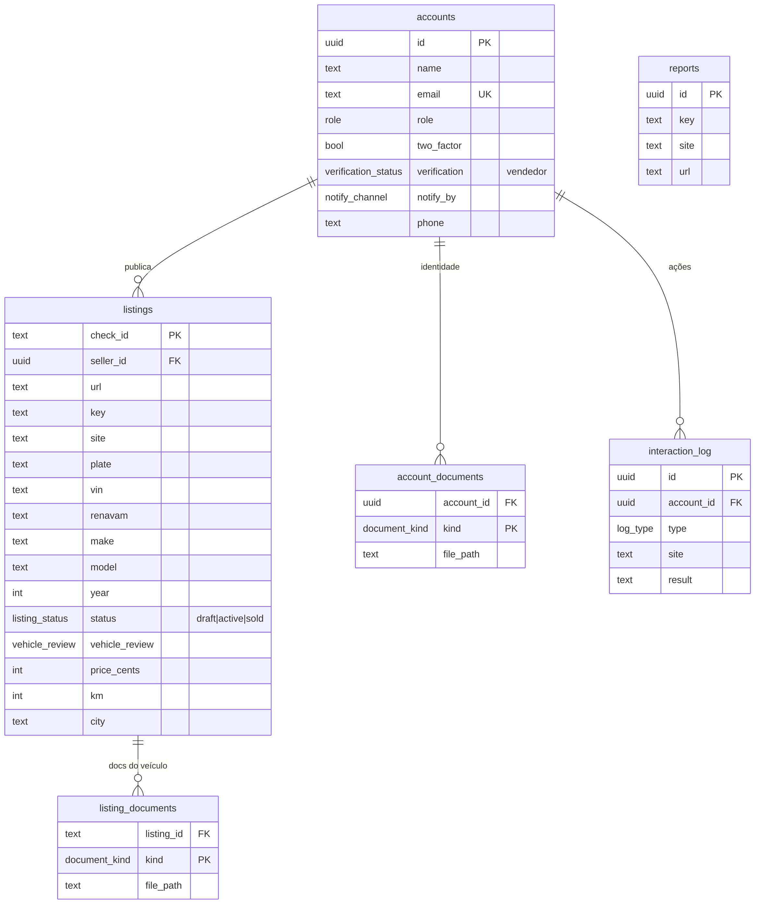

# Banco de dados (esquema)

Modelo do banco do Verify It, pronto para o dia em que houver um Postgres
hospedado. Não depende de nenhum serviço nem guarda segredo: é só a estrutura.

## Arquivos

- **`schema.sql`** — o esquema em PostgreSQL: tabelas, tipos (enums), índices e a
  trava de publicação. Rodar com `psql "$DATABASE_URL" -f db/schema.sql`.
- **`schema.mmd`** — o diagrama (fonte Mermaid) das tabelas e relações.
- **`schema.png`** — o mesmo diagrama em imagem, para documentação/Notion.

## As tabelas

- **accounts** — contas (comprador/vendedor). Sem senha: login e 2FA ficam com o
  provedor de autenticação. O vendedor tem situação de análise (`verification`) e
  canal de aviso (`notify_by`).
- **account_documents** — documentos pessoais do vendedor (identidade), enviados
  uma vez no cadastro. Guarda o caminho do arquivo no storage, não o arquivo.
- **listings** — anúncios. Nascem `draft` e só viram `active` (publicados) depois
  das aprovações; carregam os dados do veículo e os campos do marketplace.
- **listing_documents** — documentos do veículo, por anúncio.
- **reports** — denúncias de links feitas por compradores.
- **interaction_log** — histórico de ações.

## A regra que o banco também garante

A ordem "o anúncio só sobe depois de o **vendedor** ser aprovado e, então, o
**veículo**" está no app (`src/lib/verify.ts`) **e** travada no banco, por um
gatilho (`enforce_listing_publish_order`): aprovar o veículo exige o vendedor já
aprovado, e publicar exige os dois, nessa ordem. Assim nenhum caminho — app, API
ou acesso direto ao banco — consegue furar a sequência.

## Como ligar depois (resumo)

1. Criar um Postgres hospedado (Supabase, Neon, Railway, um servidor próprio...).
2. Rodar `schema.sql`.
3. Configurar os endpoints do back-end (`VITE_AUTH_ENDPOINT`, `VITE_BACKEND_ENDPOINT`)
   — ver `docs/cadastro-login-banco.md`.

Recomendado: o navegador não fala direto com o banco; uma função no servidor
guarda a chave secreta e expõe as rotas que o app já espera (nenhum segredo no
cliente). As políticas de segurança por linha (RLS) para Supabase estão
comentadas no fim de `schema.sql`.
